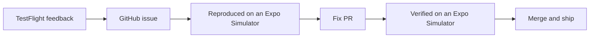
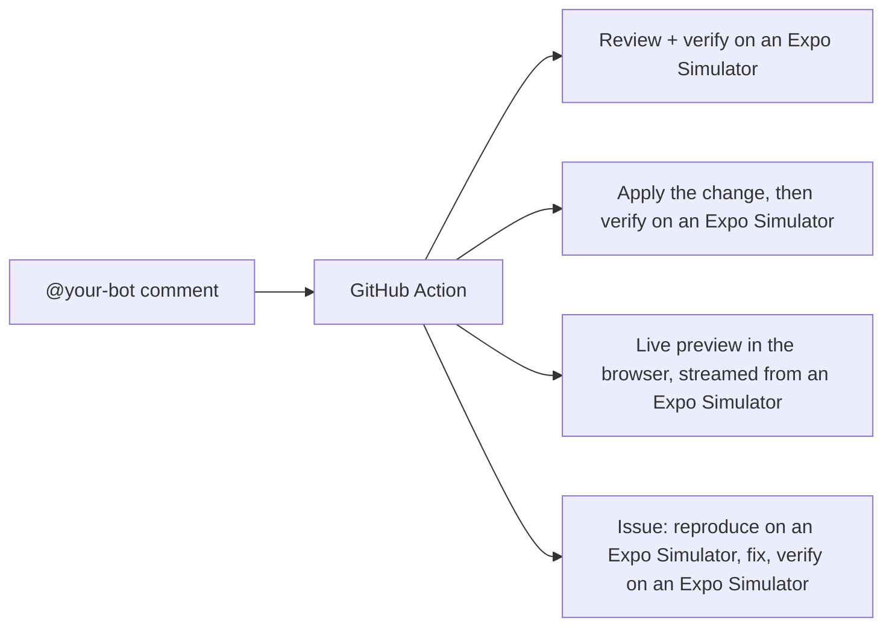
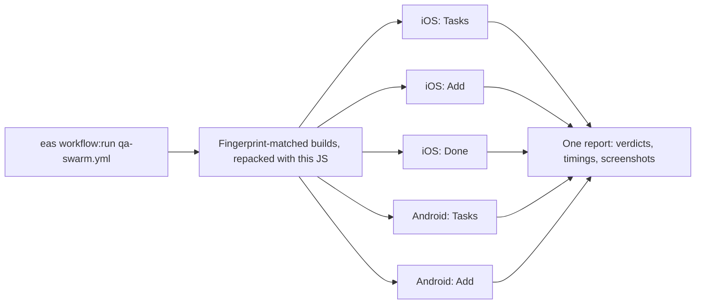

# Agentic Workflows + Expo Simulators

A demo of agentic workflows on EAS. [EAS Workflows](https://docs.expo.dev/eas/workflows/get-started/) hand work to coding agents, the agents drive the app on [Expo Simulators](https://docs.expo.dev/eas/simulators/) in the cloud, and every step leaves a verdict and screenshots on GitHub.

## Feature/Bug Agentic Workflow

1. **A tester reports a bug or feature.** They take a screenshot in the [TestFlight](https://docs.expo.dev/submit/testflight/) build, write a short description, and tap Submit.
2. **An agent files the issue.** App Store Connect [fires](https://docs.expo.dev/eas/workflows/syntax/) an [EAS Workflow](https://docs.expo.dev/eas/workflows/get-started/). An agent reads the description and the screenshot, decides whether it is a bug or a feature request, and opens a GitHub issue with reproduction steps.
3. **An agent reproduces it on an Expo Simulator.** A second workflow boots an [Expo Simulator](https://docs.expo.dev/eas/simulators/) with the right build, follows the reproduction steps, and takes screenshots as it goes. It posts a verdict on the issue: replicated or not.
4. **An agent fixes it.** If confirmed, the agent makes the fix or enhancement, and opens a pull request.
5. **Two agents verify the fix.** One reviews the diff. The other runs the PR's app on a fresh Expo Simulator and taps through the change. The verdict and the [evidence](https://github.com/jacobhammerle/eas-simulator-evidence) land on the PR.
6. **You merge.** A [fingerprint](https://docs.expo.dev/eas/workflows/pre-packaged-jobs/#fingerprint) check decides what ships: an [over-the-air update](https://docs.expo.dev/eas-update/introduction/) when only JavaScript changed, or a [new build](https://docs.expo.dev/build/introduction/) [submitted to TestFlight](https://docs.expo.dev/submit/testflight/) when native code changed.

<br>



## Comment-driven Agentic Helpers

Mention the bot on a pull request or an issue and a GitHub Action routes the comment to an [EAS Workflow](https://docs.expo.dev/eas/workflows/get-started/). Every helper runs on an [Expo Simulator](https://docs.expo.dev/eas/simulators/). The mention is yours to pick: it is the `botHandle` field in [package.json](package.json), `@expo-bot` by default, and every message and branch name follows it.

1. **`@your-bot`** or **`@your-bot review [guidance]`** on a PR. One agent reviews the diff, a second runs the PR's app on an Expo Simulator and taps through the change. The verdict and screenshots land on the PR.
2. **`@your-bot <instruction>`** on a PR. An agent applies the change, pushes to the PR branch, then an agent verifies the result on an Expo Simulator.
3. **`@your-bot preview [minutes] [ios or android] [device]`** on a PR. Boots an Expo Simulator running the PR's app and posts a browser link, so anyone can drive it. Words in any order, for example `@your-bot preview iPhone 16 Pro`.
4. **`@your-bot [guidance]`** on an issue. Starts the loop above: reproduce on an Expo Simulator, fix, verify. Guidance such as missing repro steps goes to the replication agent.

The modes are small shell scripts in [scripts/agent/](scripts/agent/), one per helper, and the agent prompts are Markdown files in [.eas/](.eas/). Add a mode, drop one, or rewrite what an agent is asked to check.

<br>



## Agentic QA Swarm

One command tests the whole app at once. Five agents each get their own [Expo Simulator](https://docs.expo.dev/eas/simulators/) in the cloud and one short flow to check, so a full pass takes as long as the slowest lane instead of five flows in a row. Every verdict comes with screenshots.

```bash
eas workflow:run qa-swarm.yml -F pr_number=<n>
```

1. **A fingerprint picks the builds.** A [fingerprint](https://docs.expo.dev/eas/workflows/pre-packaged-jobs/#fingerprint) check finds a preview build per platform whose native code matches this checkout, or builds one when native code changed.
2. **The current JavaScript goes in.** A found build still carries the JavaScript it was built with, so a [repack](https://docs.expo.dev/eas/workflows/pre-packaged-jobs/#repack) swaps in this checkout's. No update channel is touched, so a run on a PR never changes what `preview` testers see.
3. **Five lanes run at the same time.** Three iOS simulators and two Android emulators boot, each driven by a headless coding agent with one flow: toggle a task on the Tasks tab, add a task, or complete one and clear history on the Done tab. The agent reads the accessibility tree, taps through the flow, screenshots each step, and writes a verdict. A lane's job status is its verdict. This example spins up 5 at once but you could easily spin up 50 at once if you would like.
4. **One report stitches the swarm together.** Lane verdicts, timings (parallel against serial), device minutes, and the [evidence](https://github.com/jacobhammerle/eas-simulator-evidence) sites land on the run's report page, and as one PR comment with thumbnails when you pass a PR number.

The flows are short Markdown files in [.eas/qa-flows/](.eas/qa-flows/), one per lane, and a `<flow>.<platform>.md` file overrides one platform. Add a lane by adding a flow and a job in [qa-swarm.yml](.eas/workflows/qa-swarm.yml). The Admin tab is left out on purpose: switching channels there would reload the app out from under the agent.

<br>



## Try it on your own project

See [SETUP.md](SETUP.md). To run the app itself:

```bash
npm install
npx expo run:ios
```
