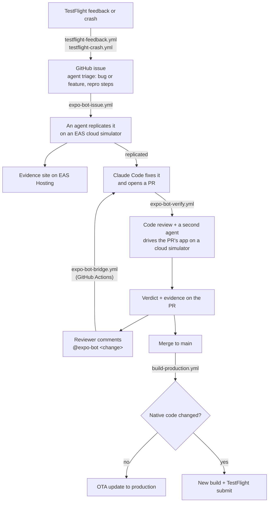

# Simple Todo, an Expo Demo

A tiny to-do app, and around it the agentic workflows that keep it shipping: TestFlight feedback that turns into triaged issues, issues that turn into verified fix PRs, and a bot you drive from GitHub comments. Every agent does its work on an [EAS Simulator](https://docs.expo.dev/eas/simulators/) in the cloud and leaves screenshots behind.

The app has no auth and no backend. It stays simple on purpose so the workflows are the star.

## Why EAS Simulators

An EAS Simulator is an iOS simulator or Android emulator that runs in the cloud. `eas simulator:start` boots one with a build preinstalled, streams it to a browser link, and stops it on a hard time limit. An agent drives it through a tool server: this repo uses [argent](https://github.com/software-mansion/argent) for the agent lanes, [Appium](https://appium.io) for a plain smoke script, and the built-in `agent-device` driver for the release gate. The session records every tap, the screen, and the device's CPU and memory, so every agent run ends with evidence a human can check.

That is what makes the loops below possible without a Mac in the pipeline: a workflow can boot five devices at once, replicate a tester's report, or verify a PR, and report back with screenshots.

## What you need

- **To run the app locally:** Node 22 or newer ([.nvmrc](.nvmrc) picks 22; `nvm use` honors it) and, for iOS, Xcode with its simulator runtime and [CocoaPods](https://cocoapods.org). Android needs Android Studio with an emulator and `ANDROID_HOME` set. No Expo account.
- **For anything through EAS:** an Expo account and a project, created in "Make it yours" below. Builds, updates, cloud simulators, and workflows all run there.
- **For the agents:** a Claude Code OAuth token (from `claude setup-token`) or an Anthropic API key, plus a GitHub token for the comments and PRs they post.
- **For TestFlight:** an Apple developer account.

## Run it

```bash
npm install
npx expo run:ios      # first time: builds the dev client and opens it in a simulator
npm start             # afterwards: starts Metro; the installed dev client reconnects to it
```

Use `npx expo run:android` for Android and `npm run web` for the browser. `npm run typecheck` and `npm run lint` are the two checks CI and the agents run.

To try updates and channel surfing you need a release build, which means an EAS project and one prior `eas build -p ios --profile preview`:

```bash
eas build:run -p ios --profile preview --latest
```

## The app

Three tabs, rendered as truly native UI. SwiftUI on iOS, Jetpack Compose on Android, and React DOM on web:

| Tab       | What it does                                                                                                                                                 |
| --------- | ------------------------------------------------------------------------------------------------------------------------------------------------------------ |
| **Tasks** | A summary card, a field to add a task, an "Add with details…" sheet for notes, priority, and a due date, the to-do list, and the three most recently done    |
| **Done**  | Completed tasks, newest first; uncheck one to send it back, or clear the history                                                                             |
| **Admin** | What this installation runs (channel, runtime, update), **switch update channels live** on a release build, and load a seed preset to reset the demo mid-run |

The app is published by a fictional company, Sunrise Solutions, which is why its ids read `com.sunrisesolutions.simpletodo`.

### Seed data

The tasks you see on launch come from [src/state/seed.ts](src/state/seed.ts). Edit that one file to change them. Each task is a plain object with relative times, so the demo looks fresh on any day:

```ts
{ title: "Buy groceries", dueIn: "1d", priority: "high" },
{ title: "Pay the rent", doneAgo: "1h" },
```

The file holds a few presets (`default`, `fresh`, `allDone`, `empty`). Set `activePreset` to pick the one that loads at launch, or open the **Admin** tab and load a preset live.

## The workflows

Every automation is one YAML file in [.eas/workflows/](.eas/workflows/), with its agent prompt in [.eas/](.eas/) and its script in [scripts/agent/](scripts/agent/). The one GitHub Action, [expo-bot-bridge.yml](.github/workflows/expo-bot-bridge.yml), turns `@expo-bot` comments into EAS workflow runs.

| Workflow                                                            | Runs when                                | What it does                                                                                                            |
| ------------------------------------------------------------------- | ---------------------------------------- | ----------------------------------------------------------------------------------------------------------------------- |
| [pr-preview.yml](.eas/workflows/pr-preview.yml)                     | a PR opens or updates                    | type-checks, lints, publishes the PR's JavaScript as an update, posts a QR code                                         |
| [pr-development-build.yml](.eas/workflows/pr-development-build.yml) | a PR opens or updates                    | posts a QR code for a development build, built only when the native fingerprint is new                                  |
| [pr-cleanup.yml](.eas/workflows/pr-cleanup.yml)                     | a branch is deleted                      | deletes the matching EAS Update branch                                                                                  |
| [build-preview.yml](.eas/workflows/build-preview.yml)               | a push to `develop`                      | refreshes the `preview` channel: an update when only JavaScript changed, new builds when native code changed            |
| [build-production.yml](.eas/workflows/build-production.yml)         | a push to `main`, after a human approves | the same for `production`, and submits iOS to TestFlight after a native change                                          |
| [release-testflight.yml](.eas/workflows/release-testflight.yml)     | you run it                               | builds an iOS store binary from the checkout and uploads it to TestFlight                                               |
| [expo-bot-verify.yml](.eas/workflows/expo-bot-verify.yml)           | `@expo-bot` on a PR                      | an agent reviews the diff, a second agent drives the PR's app on a cloud simulator, the verdict lands on the PR         |
| [pr-live-preview.yml](.eas/workflows/pr-live-preview.yml)           | `@expo-bot preview` on a PR              | boots a cloud device running the PR's app and posts the browser link                                                    |
| [expo-bot-issue.yml](.eas/workflows/expo-bot-issue.yml)             | `@expo-bot` on an issue                  | replicates the issue on a cloud simulator; if replicated, opens a fix PR and verifies it                                |
| [testflight-feedback.yml](.eas/workflows/testflight-feedback.yml)   | a tester submits feedback                | an agent triages the comment and screenshots into a GitHub issue, then triggers the issue workflow                      |
| [testflight-crash.yml](.eas/workflows/testflight-crash.yml)         | a TestFlight build crashes               | the same, from the symbolicated crash log                                                                               |
| [qa-swarm.yml](.eas/workflows/qa-swarm.yml)                         | you run it                               | five agent QA lanes on five cloud devices at once, one report                                                           |
| [deploy-gated.yml](.eas/workflows/deploy-gated.yml)                 | you run it                               | publishes to `preview`, has an agent verify the shipping diff on a cloud simulator, republishes to `production` on pass |
| [preview-watchdog.yml](.eas/workflows/preview-watchdog.yml)         | you run it                               | stops evidence-site preview sessions older than 20 minutes                                                              |

Jobs in the PR, release, and bot workflows are numbered by stage, so a run reads top to bottom on the EAS dashboard. The PR workflows skip changes that touch only Markdown, `.claude/`, `.vscode/`, or `scripts/`.

## How it ships

Two branches, two update channels, three moments where a workflow takes over:

```
feature branch ──▶ PR ──▶ develop ──▶ main
                          (preview)   (production + TestFlight)
```

- **Open a PR.** The PR's JavaScript is published as an update and two QR codes land on the PR: one to install a development build, one to load the PR into it. Native builds are reused whenever the fingerprint matches. Then talk to the bot.
- **Merge to `develop`.** The `preview` channel is refreshed. Stakeholders surf to `preview` from the Admin tab to see it on a production binary.
- **Promote `develop` to `main`.** A human approves the run. JavaScript only: an over-the-air update to `production`, so TestFlight phones get it in seconds. Native changed: new store builds, and iOS goes to TestFlight automatically.

Nobody decides "update or build". The [fingerprint](https://docs.expo.dev/eas/workflows/pre-packaged-jobs/#fingerprint) job hashes the native code and decides.

## Talk to the bot

On a pull request:

| Comment                                                 | What happens                                                                                                                            |
| ------------------------------------------------------- | --------------------------------------------------------------------------------------------------------------------------------------- |
| `@expo-bot` or `@expo-bot review [guidance]`            | review + verify: an agent reviews the diff, a second agent drives the PR's app on a cloud simulator, the verdict lands with screenshots |
| `@expo-bot <instruction>`                               | Claude Code applies the change inside the Action, pushes to the PR branch, then review + verify run                                     |
| `@expo-bot change <instruction>`                        | the change only, no EAS run                                                                                                             |
| `@expo-bot preview [minutes] [ios or android] [device]` | a simulator or emulator running the PR, streamed to your browser. Words in any order, for example `@expo-bot preview iPhone 16 Pro`     |

On an issue, `@expo-bot [guidance]` runs the triage and fix loop below. Guidance after the mention (missing repro steps, for example) goes to the replication agent.

## TestFlight feedback loop

Real devices run the `production` build from TestFlight. A tester takes a screenshot, writes a sentence, and taps Submit. Nobody opens a laptop after that:



Each agent is a headless [Claude Code](https://claude.com/claude-code) run with a narrow prompt and a narrow `--allowedTools` list. Every stage reports back as one GitHub comment in the same shape: a heading, a **Verdict** or **Status** line with a status emoji, links to the PR and the evidence site, the update channel to surf to, a row of screenshot thumbnails, and the full report folded away.

The evidence site (verdict, screenshots, the agent's action timeline, CPU and memory charts, the session recording) comes from [eas-simulator-evidence](https://github.com/jacobhammerle/eas-simulator-evidence), a package that grew out of this repo. The scripts call its `run` command to collect the session's artifacts, build the page, and deploy it to EAS Hosting, and its `verdict`, `thumbs`, and `comment` commands for the comment shape. The watchdog uses its `sweep`.

| Stage           | What happens                                                                                                                                                                                                                                                                                  |
| --------------- | --------------------------------------------------------------------------------------------------------------------------------------------------------------------------------------------------------------------------------------------------------------------------------------------- |
| Intake          | An agent reads the tester's comment and screenshots, decides bug vs feature request, and files a GitHub issue with repro steps (labels: `testflight` + `bug` or `enhancement`)                                                                                                                |
| Triage          | An agent follows the repro steps on an EAS cloud simulator, publishes screenshot evidence to EAS Hosting, and posts a verdict on the issue                                                                                                                                                    |
| Fix             | If replicated, Claude Code makes the smallest fix, passes the type-check and lint, opens a PR on `expo-bot/issue-N` with the replication screenshots inline, and dispatches verification on it ([fix-issue.sh](scripts/agent/fix-issue.sh))                                                   |
| Review + verify | An agent reviews the diff; a second agent runs the PR's app (repacked into the matching binary) on a cloud simulator, taps through the change, and posts the verdict with evidence. The PR's JavaScript also lands on its own `pr-N` update channel, so you can surf to it from the Admin tab |
| Iterate         | A reviewer comments `@expo-bot <change>`; an agent applies it, pushes, and review + verify re-run                                                                                                                                                                                             |
| Ship            | On merge, the fingerprint check picks between an instant update and a new build submitted to TestFlight                                                                                                                                                                                       |

## QA swarm and the release gate

[qa-swarm.yml](.eas/workflows/qa-swarm.yml) runs five agentic QA lanes at the same time, each on its own EAS cloud device: three iOS simulators (Tasks, Add, Done) and two Android emulators (Tasks, Add). The fingerprint job finds matching preview binaries, a repack job injects the checkout's JavaScript into each one, and every lane boots its device with that binary preinstalled. A lane's job status is its verdict. The report stitches the lanes together: pass count, wall clock in parallel versus one lane after another, device commands and taps per lane, device-minutes for the fleet, and a screenshot row from the evidence sites at `qa-<platform>-<flow>-evidence`. Run it with `eas workflow:run .eas/workflows/qa-swarm.yml`; pass `-F pr_number=<n>` to also post the report as one PR comment.

The flows the lanes follow are plain prose in [.eas/qa-flows/](.eas/qa-flows/), one file per flow, with an optional per-platform override such as `tasks.android.md`.

[deploy-gated.yml](.eas/workflows/deploy-gated.yml) is the release gate. It publishes the checkout to `preview`, checks that the Tasks screen rendered on a cloud simulator, then lets an agent read the diff that is shipping and derive its own checks from it. Only a pass republishes the same update to `production`. It drives the simulator with the `agent-device` session type, the third driver this repo shows, so the gate reads as its own pattern.

## Channel surfing

On a release build, the Admin tab can switch the running app between `preview` and `production`, or to any channel you type. On switch the app downloads that channel's latest update and reloads on the spot. QA and stakeholders preview in-progress work **on the production binary** by surfing to `preview`, or to a single PR's `pr-N` channel, which the verify workflow publishes for every PR it checks. Several PRs can be in flight at once without touching each other.

`fallbackToCacheTimeout` in [app.json](app.json) is set to 15 seconds so a fresh launch waits for the channel's newest update instead of showing the cached one first. That is a demo setting; most apps keep it at 0.

## Critical updates

Ordinary updates apply on the next launch. For the fix that can't wait, publish a **critical update**:

```sh
npm run update:critical -- --channel preview --message "Hotfix"
```

Running apps poll every 15 seconds in this demo, show a banner, and relaunch themselves on the new code. No user action needed.

After a demo, put the channel back to a clean baseline in one command:

```sh
npm run demo:reset -- --channel preview  # or --all for preview and production
```

Devices roll back to the update embedded in their build (applied on next launch), the script verifies each branch is serving the rollback, and `criticalIndex` in app.json is restored to the committed value so the next critical-update demo starts fresh.

## Make it yours

This repo is a worked example of agentic workflows on Expo. Nothing in it carries a credential, and every token the workflows spend is one you added yourself. To run it against your own project:

1. **Create your Expo project.** Run `npx eas-cli@latest init` to create or link a project; it writes `owner` and `extra.eas.projectId` into [app.json](app.json). Then `npx eas-cli@latest update:configure` to add the updates URL. Leave `runtimeVersion` out of app.json: [app.config.ts](app.config.ts) derives it from the version. Pick your own `ios.bundleIdentifier` and `android.package`; the agent prompts and scripts read them from app.json.
2. **Name your GitHub repo** in the `repository` field of [package.json](package.json). The workflow scripts read it to post comments and open PRs. An EAS environment variable named `GH_REPO` overrides it.
3. **Add your tokens** (table below). Every workflow fails fast and names the missing variable when one is absent.
4. **Connect GitHub on expo.dev** (project → Settings → GitHub) and push the workflow files to your default branch, so `push`, `pull_request`, and App Store Connect triggers fire.
5. **Set up TestFlight** (next section) when you want the feedback loop.

### Bring your own tokens

| Where                          | Name                                               | Used by                                                                                                            |
| ------------------------------ | -------------------------------------------------- | ------------------------------------------------------------------------------------------------------------------ |
| GitHub → Settings → Secrets    | `EXPO_TOKEN`                                       | [expo-bot-bridge.yml](.github/workflows/expo-bot-bridge.yml): dispatches EAS workflows                             |
| GitHub → Settings → Secrets    | `CLAUDE_CODE_OAUTH_TOKEN` (or `ANTHROPIC_API_KEY`) | the bridge's change modes, which run Claude Code inside the Action                                                 |
| EAS → environment `production` | `EXPO_TOKEN_SIMULATOR`                             | a personal access token; EAS Simulator sessions are actor-gated, so the worker's own robot token cannot start them |
| EAS → environment `production` | `CLAUDE_CODE_OAUTH_TOKEN` (or `ANTHROPIC_API_KEY`) | every agent job: review, verify, triage, fix, QA swarm, release gate, TestFlight triage                            |
| EAS → environment `production` | `GITHUB_TOKEN`                                     | a fine-grained token with issues, pull requests, and contents write on your repo; posts comments, opens fix PRs    |

The build profiles in [eas.json](eas.json) use the EAS environments `development`, `preview`, and `production`; the agents read their variables from `production`. The Claude Code agents accept either `CLAUDE_CODE_OAUTH_TOKEN` (from `claude setup-token`, billed to your Claude subscription) or `ANTHROPIC_API_KEY` (billed to your API account). When both are set the scripts unset the API key, so the OAuth token wins. The model each agent uses is a `--model` flag in [scripts/agent/](scripts/agent/); change it there.

### Who can spend them

- `@expo-bot` only answers comments whose author is the repository owner, an organization member, or a collaborator. That is the `if` gate on the job in [expo-bot-bridge.yml](.github/workflows/expo-bot-bridge.yml). Any other comment is ignored: no Action runs, no secret is read.
- The bridge refuses pull requests from forks, and EAS never runs `pull_request` workflows for fork PRs, so an outside PR costs no agent tokens and no EAS minutes.
- Secrets stay in your GitHub repository and your EAS project. A fork of this repo starts with none of them and does nothing until its owner adds their own.
- The TestFlight triggers fire only for testers you invited in App Store Connect.
- Every simulator session carries a hard `--max-duration-minutes`, and every agent run has a `timeout` and a `--max-turns` cap, so a stuck run has a bounded cost. Run [preview-watchdog.yml](.eas/workflows/preview-watchdog.yml) to stop evidence-site preview sessions that outlived their 20 minutes.

### TestFlight setup

The TestFlight side needs Apple credentials that only an interactive session can create:

1. `npx eas-cli@latest build -p ios --profile production --submit` from your machine. Sign in with your Apple ID when asked; EAS creates the distribution certificate, the provisioning profile, an App Store Connect API key, and the App Store Connect app record, then uploads the first build. Add the new app's id as `submit.production.ios.ascAppId` in [eas.json](eas.json) so later submits skip the lookup.
2. In App Store Connect, add yourself as an internal tester and install the build from the TestFlight app.
3. On expo.dev, open the project's **Settings → General → Connections** and connect the App Store Connect app. This enables the `app_store_connect` triggers.
4. Merge the workflow files to `main`; App Store Connect triggers read workflows from the default branch.
5. Check the wiring without waiting for a real report: `eas workflow:run .eas/workflows/testflight-feedback.yml` files an issue from the newest submission.

Later native releases need no laptop: `eas workflow:run .eas/workflows/release-testflight.yml` builds and uploads, and every native change merged to `main` is submitted by `build-production.yml`.

### Claude Code files

The repo ships its own Claude Code setup. [.mcp.json](.mcp.json) registers two MCP servers: Expo's hosted one and [argent](https://github.com/software-mansion/argent) for driving simulators (`npm i -g @swmansion/argent` puts the `argent` command on your PATH). [.claude/settings.json](.claude/settings.json) enables the Expo plugin and pre-approves the argent tools, so an agent can tap through the app without a permission prompt per call. The argent playbooks live in [.agents/skills/](.agents/skills/), vendored at the version pinned in [skills-lock.json](skills-lock.json); [.claude/skills/](.claude/skills/) symlinks to them. [AGENTS.md](AGENTS.md) holds the repo facts an agent needs. Claude Code still asks before it starts a project MCP server for the first time. Delete these files if you do not want them.

## Appendix: the no-agent baseline

[appium-smoke.mjs](scripts/appium-smoke.mjs) is an ordinary WebdriverIO script that walks every tab on an EAS Simulator Appium session and saves a screenshot per screen. Its header has the three `eas simulator:*` commands that run it. It is the control group: the same cloud device, driven without an agent.
